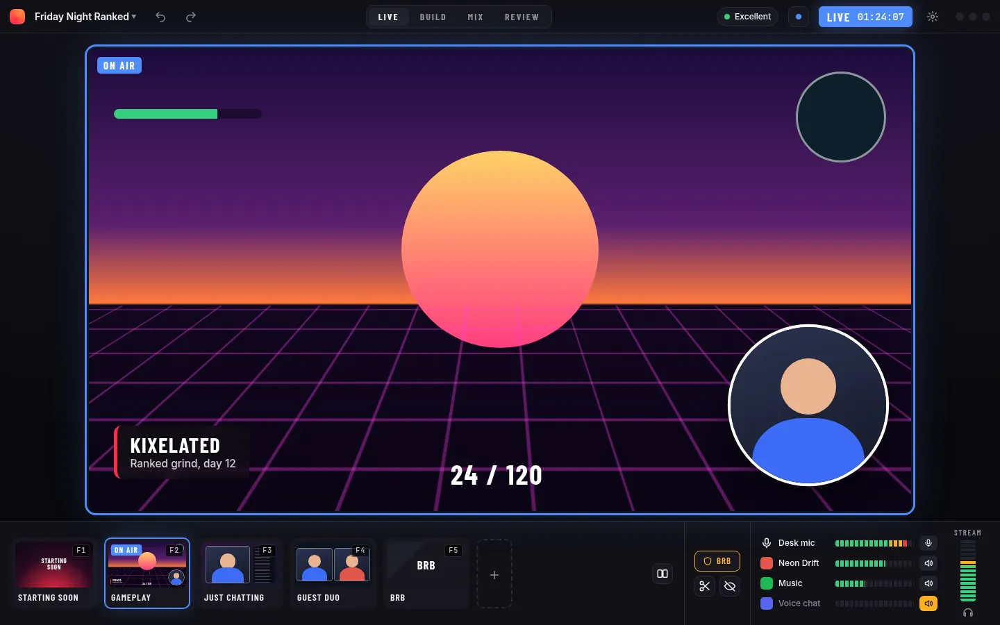
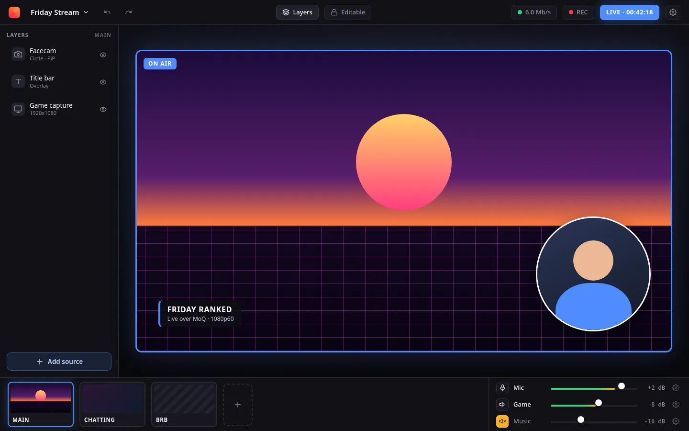

# Broadcaster UX

## Goal

A broadcaster opens the studio to one live picture, with the scenes, the sound
levels, the state of the stream, and a panic key always on screen. Everything
else is on a page, in the selected layer's inspector, or in Settings, and an
edit changes what is on air. An optional Studio mode adds cue and take for
broadcast operators.

It replaces sixteen dockable text panels, a Preview and Program pair, and
command-line flags for what a broadcaster must set before going live.

Non-goals: media or protocol work, which stays in moq; a plugin API; and
integrations built on any one platform's API. Chat, activity, and dashboards
reach the studio as [private panels](/quest/m1/panels.md), any web page shown
beside the show and never in it.

This README's own work, once every child has merged: `README.md`'s Panels
section is rewritten around the pages, with a picture of each from
`just shots`, and the maintainer runs one real show start to finish on the
finished UI.

## Plan

Decided 2026-11-09 with the maintainer (/quest-plan). The mock-ups in
[`mock/`](/quest/m0/ux/mock/shell.html) are the reference for every child: HTML
pages drawn at 1440x900, each frame rendered beside it as
`<page>-<frame>.webp` by `mock/render.sh`. They fix layout, hierarchy, and
tone. The app is native, so a child matches them in what is where and how it
reads, not pixel for pixel, and a child that has to depart from one changes
the mock-up in the same PR.
Each child adds a view to `just shots` (the table in
`rs/moq-studio/src/shots.rs`) for every page and state it builds, and its PR
shows those pictures beside the frames they implement.

### Decisions

- **Shape:** ✅ one live picture with pages around it (rejected: a hardware
  console under the picture, which spends a third of the window on controls a
  solo streamer drives by hotkey; workspaces that lock editing on the live
  page; a restyle of today's panels).
- **Pages:** ✅ LIVE, BUILD, MIX, and REVIEW (rejected: a left rail of
  drawers). They sit in the title bar when the show is landscape and in a left
  sidebar when it is portrait, where the spare room is (rejected: always along
  the bottom, which costs a landscape picture its height).
- **Live editing:** ✅ no Preview monitor. A scene click takes that scene, and
  an edit applies on air. Any scene can be opened for editing off air: the
  frame turns amber, the live picture shrinks to a corner, and one button
  takes it live or goes back.
- **Studio mode:** ✅ cue and take, off by default (rejected: a Preview and
  Program split, which halves the live picture; no mode at all). A scene click
  cues, and TAKE or AUTO puts it on air.
- **One control per state:** the live control reads LIVE with the clock,
  which asks before it ends the stream. One health dot stands for every
  destination, the viewers, and the encoder, which its hover lists. Undo,
  record, and settings are icons with tooltips.
- **Not on the home page:** the format, canvas size, and frame rate, which a
  broadcaster sets once. They live in Settings.
- **Panels:** ✅ chat and other private panels are their own windows, hidden
  from capture, dockable into spare room but never docked by default
  (rejected: a chat column in the main window; leaving chat to the browser).
- **Formats:** ✅ one format per show in m0, landscape or portrait, and the
  layout follows it. [Both at once](https://github.com/moq-dev/studio/pull/200) is m1 (rejected:
  designing every m0 page for two pictures).
- **Layout follows the picture:** ✅ the picture is larger than any other
  part of the window but the title bar, as large as the window allows, and
  the scenes and the sound take whichever side is left over (rejected: the
  largest rectangle, which a full-width title bar outsizes beside a portrait
  picture in a narrow window). See the portrait and half-screen frames.
- **Toolkit:** ✅ egui draws the views, without `egui_dock` (rejected:
  Slint; defer until a Slint release takes femtovg 0.28). A spike of the LIVE
  page in both ([moq-dev/studio#126](https://github.com/moq-dev/studio/pull/126))
  measured egui's UI CPU at about 0.5 ms a frame, against Slint's 12 to 16 ms
  as released and 3 to 5 ms with femtovg's pipeline cache patched. Patched
  Slint also made the program render about four times slower, and Slint's
  licenses require GPLv3 or attribution with an embedded ban. egui's gaps
  (SVG icons, gradients) are painter work, done in the kit
  (`rs/moq-studio/src/kit`).
- **Color:** ✅ one shared accent (`kit::ACCENT`, `--accent` in
  `mock/kit.css`), blue until proper branding replaces that one value, for
  what is on air (the ON AIR tag, the tally frame, the live control) and for
  selection, toggles, and sliders (rejected: a separate token for on air).
  Red is errors alone, a clipping meter among them; amber is cued, off air,
  muted, and degraded (rejected: red for the program, as hardware switchers
  do; red or amber for both a mute and a clip). Decided by the maintainer in
  [moq-dev/studio#164](https://github.com/moq-dev/studio/pull/164#issuecomment-6887308961).
- **Milestones:** ✅ redesigning what exists is m0, here. Features that do not
  exist yet are [m1](/quest/m1/README.md), and three more are
  [m2](/quest/m2/README.md) (rejected: all in m0; all in m1).
- **Mods:** ✅ features most streamers never use are off until switched on
  in Settings > Mods, and absent from every page until then: Both formats,
  Studio mode, Multiview, Phone remote, Published scenes, and Scene graph
  (rejected: leaving them on the pages and in Advanced). Decided 2026-11-20
  (maintainer, /quest-plan). Settings > Mods holds them.
- **Dropped:** a rundown that fills overlays, one-click looks and a brand kit,
  active-speaker layouts, control surfaces, and a rehearsal mode. Not planned.

### 2026-11-22 UX Simplification Overhaul

Decided 2026-11-22 with the maintainer (/quest-plan) after auditing the
implemented 4-page UI (`just shots` and source). The redesign cuts interaction
counts for common operations and removes mode switching and chrome tax. Its
reference mock-ups live in [`mock/overhaul.html`](/quest/m0/ux/mock/overhaul.html):

- **Workspace & pages:** ✅ single unified Studio workspace merging LIVE and
  BUILD, with a directly editable canvas, an Editable/Locked toggle, a
  collapsible Layers rail, inline audio volume sliders in a slimmer bottom
  dock, and MIX / REVIEW hidden unless their Mods are enabled (rejected:
  two-page Studio + Mix layout; keeping all four top-level tabs LIVE, BUILD,
  MIX, REVIEW). See [Unified Studio shell](/quest/m0/ux/unified-shell.md).
- **Startup & shows:** ✅ zero-gate startup that auto-creates or reopens the
  last show in app data immediately with a clean empty-canvas one-click
  quick-start prompt, moving show switching, creation, and export into the
  title bar's Show menu (rejected: one-screen quick starter wizard on first
  launch; keeping the Library landing screen and 4-step wizard). Done in
  [moq-dev/studio#237](https://github.com/moq-dev/studio/pull/237).
- **Adding sources & editing layers:** ✅ one-click immediate Add from an
  auto-populated modal/popover with smart non-overlapping placement and native
  file pickers, plus a contextual right-hand Inspector that opens only while a
  layer is selected, removes controls duplicated from the canvas toolbar, binds
  `Delete`/`Backspace`, and tucks advanced geometry, crop %, blend, and filters
  under a collapsed `More` section (rejected: keeping all layer fields visible
  in accordions; canvas-only editing with no inspector; two-click select then
  Add). See [Adding a source](/quest/m0/ux/add.md) and
  [Essential layer inspector](/quest/m0/ux/essential-inspector.md).
- **Audio & bottom dock:** ✅ horizontal volume sliders, live meters, mute, and
  per-source options popovers (headphones monitor, delay, pan, filters) inline
  in the bottom dock; multi-bus Audio Scenes & Routes, Replay & Review, and
  Smart Layout (Slots + Keep out of the way) move behind Settings > Mods;
  off-air Panic/Clip/Marker chrome stays hidden when unused (rejected: keeping
  a dedicated simplified Mix page always visible; keeping Audio Scenes on by
  default). See [Unified Studio shell](/quest/m0/ux/unified-shell.md).
- **Go Live, Settings & Palette:** ✅ background encoder/uplink health checks,
  one-click Go Live once configured, inline destination URL/key setup on first
  use, click-to-confirm End Stream popover replacing the hidden 1.2s hold,
  auto-saving across every Settings pane, clear REC label, and hiding
  unavailable actions in the command palette (rejected: blocking preflight
  probes on every Go Live click; 8-step Settings detour; manual Save/Revert
  buttons in Stream and Guests).
- **Agent controllability:** ✅ enable AccessKit in `eframe`, fix widget
  labels, add a live/headless Unix-socket control server and `moq-studio ctl`
  CLI, and ship headless `sway` + `grim` in `flake.nix` (rejected: leaving
  agents on static `shots.rs` enums). Done: `moq-studio --control` and
  `moq-studio ctl` in the [README](/README.md#driving-the-studio).

### What is where

The default window holds one directly editable canvas, a collapsible Layers
rail, and a slim bottom dock of scene pads and inline audio sliders. Extra
pages (`MIX`, `REVIEW`) and power-user tools appear only when enabled in
Settings > Mods.

| Default workspace | Popovers & modals | In Settings |
| --- | --- | --- |
| Live directly editable canvas + Editable/Locked toggle | Add modal: auto-populated devices/screens, file pickers, web URL, audio, guests | Show: format, canvas size, frame rate, transition |
| Collapsible Layers rail & contextual layer Inspector (when selected) | Per-source audio popover: headphones monitor, delay, pan, filters | Destinations: MoQ/RTMP/WHIP (auto-saved, failover under Advanced) |
| Slim bottom dock: scene pads (`+` switches immediately) + inline volume sliders & meters | Go Live popover (inline URL setup on first use) & End Stream confirm popover | Recording, Hotkeys, Guests (all auto-saved) |
| Slim title bar: Show menu (switch/new/export/history), undo/redo, health pill, REC, GO LIVE, gear | Command palette (`Ctrl+K`, available actions only) | Mods: Audio Scenes & Routes, Replay & Review, Studio Mode, Smart Layout, Both formats, Multiview, Phone remote, Published scenes, Scene graph |

### The frames

| Frame | Shows |
| --- | --- |
| [first](/quest/m0/ux/mock/overhaul-first.webp), [studio](/quest/m0/ux/mock/overhaul-studio.webp) | Zero-gate first launch with empty-canvas quick-start, and the unified Studio workspace on air |
| [edit](/quest/m0/ux/mock/overhaul-edit.webp), [add](/quest/m0/ux/mock/overhaul-add.webp) | Selected layer with non-duplicated toolbar and minimal contextual inspector, and the 1-click Add modal |
| [popovers](/quest/m0/ux/mock/overhaul-popovers.webp), [mods](/quest/m0/ux/mock/overhaul-mods.webp) | Inline per-source audio options and inline Go Live setup, and Settings > Mods |
| [studio](/quest/m0/ux/mock/shell-studio.webp), [portrait](/quest/m0/ux/mock/shell-portrait.webp), [compact](/quest/m0/ux/mock/shell-compact.webp) | Reference layouts when Studio mode or portrait/compact modes are active |

`add.html`, `firstrun.html`, `mix.html`, `settings.html`, `review.html`, and
`golive.html` hold the other m0 pages, and `later.html` the m1 features; each
quest links its own.

### Borrowed

- Editing the live picture, with layers beside it: Meld Studio and StreamYard,
  which stay safe by constraining what a click can do.
- Cue and take, a tally for program and amber for preview: hardware switchers,
  which draw the program red where this draws it in the accent.
  vMix and OBS Studio Mode show the cost of the split this plan rejects.
- Selection handles, smart guides, a toolbar on the selected thing, and an
  inspector that follows the selection: Figma and Keynote.
- Pages for kinds of work: DaVinci Resolve.
- Sends as a matrix of sounds against mixes: Wave Link.
- The first-run format choice before any scene exists: mobile-first studios.
- OBS 32.2's add-source dialog with thumbnails, which this goes past with app
  icons and live pictures.

### What a person must check

An agent can prove a page matches its mock-up's layout, that nothing clips at
any window size, and what a frame costs. It cannot judge these, so each child's
PR adds a follow-up quest for the maintainer to try the page, such as
[Try the LIVE page](/quest/m0/ux/try-live.md), with a `Maintainer:` item saying
what to look at, rather than waiting on it:

- **Taste:** whether the page reads as bold and calm at once. The PR shows its
  screenshots beside the mock-up frames.
- **Feel:** drag latency, how a scene change and a tally change move, the hold
  to end a stream. The PR attaches a short recording, and the maintainer tries
  it on their own machine.
- **Real devices:** cameras, capture cards, microphones, a second monitor, and
  mixed display scales. The agent hosts have no camera.
- **System dialogs:** permission prompts and the operating system's own window
  pickers, which no headless run can answer.
- **A real stream:** going live to a real destination with the maintainer's
  credentials, and ending it.
- **Other apps in front:** hotkeys, and later the mini controller, while a
  full-screen game has focus.
- **Readability:** contrast, and the accent, amber, and red told apart by a
  color-blind reader.

## Related

- [m1](/quest/m1/README.md) - the features that follow the redesign
- [Destinations](/quest/m0/destinations.md) - RTMP and WHIP rows in the Go live popover and the Destinations pane this epic builds
