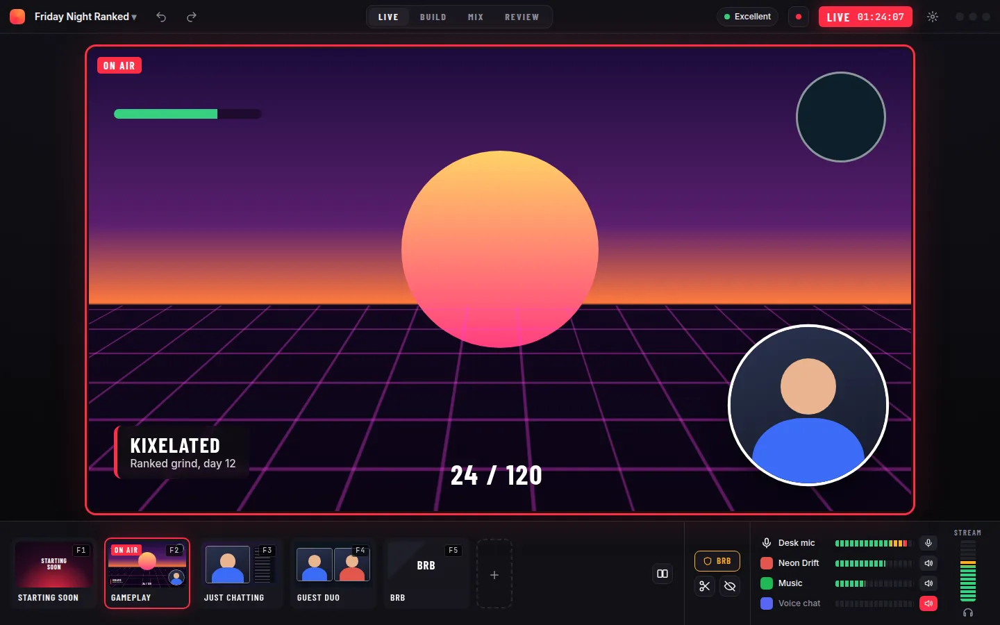

# Broadcaster UX

## Goal

A broadcaster opens the studio to one live picture, with the scenes, the sound
levels, the state of the stream, and a panic key always on screen. Everything
else is on a page, in the selected layer's inspector, or in Settings, and an
edit changes what is on air. An optional Studio mode adds cue and take for
broadcast operators.

It replaces sixteen dockable text panels, a Preview and Program pair, and
command-line flags for what a broadcaster must set before going live.

Non-goals: media or protocol work, which stays in moq; a plugin API; and
integrations built on any one platform's API. Chat, activity, and dashboards
reach the studio as [private panels](/quest/m1/panels.md), any web page shown
beside the show and never in it.

This README's own work, once every child has merged: `README.md`'s Panels
section is rewritten around the pages, with a picture of each from the
[screenshots](/quest/m0/ux/shots.md), and the maintainer runs one real show
start to finish on the finished UI.

## Plan

Decided 2026-11-09 with the maintainer (/quest-plan). The mock-ups in
[`mock/`](/quest/m0/ux/mock/shell.html) are the reference for every child: HTML
pages drawn at 1440x900, each frame rendered beside it as
`<page>-<frame>.webp` by `mock/render.sh`. They fix layout, hierarchy, and
tone. The app is native, so a child matches them in what is where and how it
reads, not pixel for pixel, and a child that has to depart from one changes
the mock-up in the same PR.

### Decisions

- **Shape:** ✅ one live picture with pages around it (rejected: a hardware
  console under the picture, which spends a third of the window on controls a
  solo streamer drives by hotkey; workspaces that lock editing on the live
  page; a restyle of today's panels).
- **Pages:** ✅ LIVE, BUILD, MIX, and REVIEW (rejected: a left rail of
  drawers). They sit in the title bar when the show is landscape and in a left
  sidebar when it is portrait, where the spare room is (rejected: always along
  the bottom, which costs a landscape picture its height).
- **Live editing:** ✅ no Preview monitor. A scene click takes that scene, and
  an edit applies on air. Any scene can be opened for editing off air: the
  frame turns amber, the live picture shrinks to a corner, and one button
  takes it live or goes back.
- **Studio mode:** ✅ cue and take, off by default (rejected: a Preview and
  Program split, which halves the live picture; no mode at all). A scene click
  cues, and TAKE or AUTO puts it on air.
- **One control per state:** the live control reads LIVE with the clock and
  becomes END STREAM under the pointer. One health dot stands for every
  destination, the viewers, and the encoder, which its hover lists. Undo,
  record, and settings are icons with tooltips.
- **Not on the home page:** the format, canvas size, and frame rate, which a
  broadcaster sets once. They live in Settings.
- **Panels:** ✅ chat and other private panels are their own windows, hidden
  from capture, dockable into spare room but never docked by default
  (rejected: a chat column in the main window; leaving chat to the browser).
- **Formats:** ✅ one format per show in m0, landscape or portrait, and the
  layout follows it. [Both at once](/quest/m1/dual-format.md) is m1 (rejected:
  designing every m0 page for two pictures).
- **Layout follows the picture:** the picture gets the largest rectangle the
  window allows, and the scenes and the sound take whichever side is left
  over. See the portrait and half-screen frames.
- **Toolkit:** ✅ decided by a spike of the LIVE page
  ([moq-dev/studio#126](https://github.com/moq-dev/studio/pull/126)) in egui
  and in Slint before any page is built (rejected: staying on egui
  unasked; egui against Rune, which
  [moq-dev/studio#98](https://github.com/moq-dev/studio/pull/98) already
  spiked). Only those two draw the compositor's own textures with no copy on
  the studio's own device today.
- **Milestones:** ✅ redesigning what exists is m0, here. Features that do not
  exist yet are [m1](/quest/m1/README.md), and three more are
  [m2](/quest/m2/README.md) (rejected: all in m0; all in m1).
- **Dropped:** a rundown that fills overlays, one-click looks and a brand kit,
  active-speaker layouts, control surfaces, and a rehearsal mode. Not planned.

### What is where

The first column holds on every page, not only LIVE. The bottom strip of
scene pads, panic key, and sound is on all four. On MIX, which is the sound,
its sound slot holds a small live picture instead, and on REVIEW the
program's card is the live picture.

| Always on screen | On a page | In Settings |
| --- | --- | --- |
| The live picture and its tally frame | BUILD: layers, adding a source, the inspector, keyframes | Format, canvas size, frame rate, scene sizes |
| Scene pads with live thumbnails | MIX: every strip, sends, filters, delay | Where the stream goes, keys, failover |
| A meter and a mute for each sound on air | REVIEW: replay, clips, recordings | Recording folder and contents |
| The live control, health dot, and record | Health details, from the health dot | Hotkeys, virtual camera, guests' room |
| The panic key | Guests, from Add | Effects, published scenes, the scene graph, edit history |

### The frames

| Frame | Shows |
| --- | --- |
| [live](/quest/m0/ux/mock/shell-live.webp), [hover](/quest/m0/ux/mock/shell-hover.webp) | The LIVE page, and what the health dot, the live control, and an icon show under the pointer |
| [build](/quest/m0/ux/mock/shell-build.webp), [offair](/quest/m0/ux/mock/shell-offair.webp) | The BUILD page on air, and editing a scene that is not |
| [studio](/quest/m0/ux/mock/shell-studio.webp) | Studio mode: a cued scene, NEXT, TAKE, and AUTO |
| [portrait](/quest/m0/ux/mock/shell-portrait.webp), [compact](/quest/m0/ux/mock/shell-compact.webp) | The layout following a portrait show, and a window snapped beside a game |

`add.html`, `firstrun.html`, `mix.html`, `settings.html`, `review.html`, and
`golive.html` hold the other m0 pages, and `later.html` the m1 features; each
quest links its own.

### Borrowed

- Editing the live picture, with layers beside it: Meld Studio and StreamYard,
  which stay safe by constraining what a click can do.
- Cue and take, red for program and amber for preview: hardware switchers.
  vMix and OBS Studio Mode show the cost of the split this plan rejects.
- Selection handles, smart guides, a toolbar on the selected thing, and an
  inspector that follows the selection: Figma and Keynote.
- Pages for kinds of work: DaVinci Resolve.
- Sends as a matrix of sounds against mixes: Wave Link.
- The first-run format choice before any scene exists: mobile-first studios.
- OBS 32.2's add-source dialog with thumbnails, which this goes past with app
  icons and live pictures.

### What a person must check

An agent can prove a page matches its mock-up's layout, that nothing clips at
any window size, and what a frame costs. It cannot judge these, so each child's
PR hands them to the maintainer as `## Waiting` with what to look at:

- **Taste:** whether the page reads as bold and calm at once. The PR shows its
  screenshots beside the mock-up frames.
- **Feel:** drag latency, how a scene change and a tally change move, the hold
  to end a stream. The PR attaches a short recording, and the maintainer tries
  it on their own machine.
- **Real devices:** cameras, capture cards, microphones, a second monitor, and
  mixed display scales. The agent hosts have no camera.
- **System dialogs:** permission prompts and the operating system's own window
  pickers, which no headless run can answer.
- **A real stream:** going live to a real destination with the maintainer's
  credentials, and ending it.
- **Other apps in front:** hotkeys, and later the mini controller, while a
  full-screen game has focus.
- **Readability:** contrast, and red against amber for a color-blind reader.

## Related

- [m1](/quest/m1/README.md) - the features that follow the redesign
- [Destinations](/quest/m0/destinations.md) - RTMP and WHIP rows in the go-live sheet this epic builds
- [Wayland display and window sources](/quest/m0/wayland-sources.md) - the system picker the Add page opens
